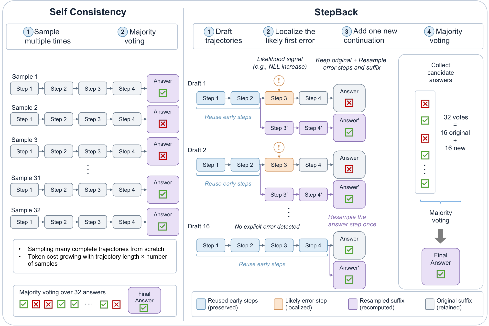
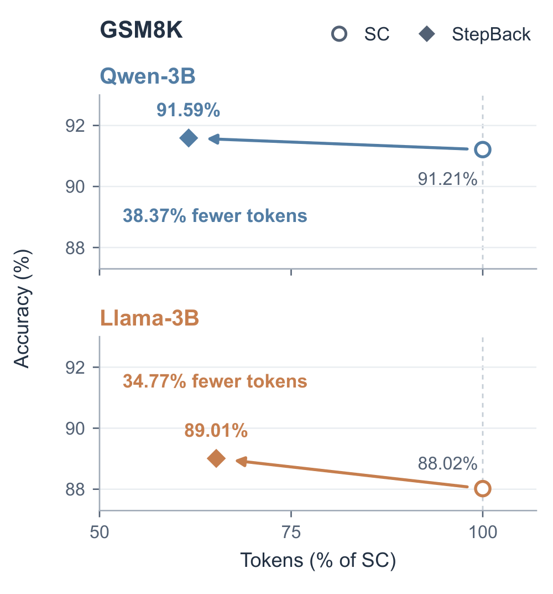

<h1 align="center">StepBack: Step-Level Error-Localized Resampling for Efficient Test-Time Reasoning</h1>

<p align="center"><b>NeurIPS 2026</b></p>

<p align="center">
  <a href="https://openreview.net/forum?id=skhKf04svt"><b>📄 Paper</b></a> &nbsp;|&nbsp;
  <a href="#citation"><b>📝 Citation</b></a>
</p>

<p align="center">
  <a href="https://openreview.net/forum?id=skhKf04svt"></a>
  <a href="LICENSE"></a>
</p>

Self-consistency (SC) samples many complete reasoning trajectories, so its cost
grows with both the number and the length of the trajectories. **StepBack**
reuses the valid early steps of a few draft trajectories instead. It localizes
the likely first erroneous step with a lightweight signal, rolls back to that
step, and resamples only the erroneous step and its suffix before majority
voting with the same answer budget.



## Method

1. **Draft.** Sample a few chain-of-thought trajectories and split them into steps.
2. **Localize.** Find the likely first erroneous step with a step-level signal.
3. **Roll back and resample.** Keep the steps before the error and sample a new
   continuation from there. If no error is detected, resample only the final
   answer step.
4. **Vote.** Majority-vote over the original and the new answers.

Rollback signals (`--rollback-signal`):

| Signal | Description |
|---|---|
| `nll` (default) | step-level negative log-likelihood of the policy model |
| `prm` | step scores from [Qwen2.5-Math-PRM-7B](https://huggingface.co/Qwen/Qwen2.5-Math-PRM-7B) |
| `last` | roll back to the last step |

## Results

<p align="center"></p>

Comparison with SC@32 at the same budget of 32 candidate answers, using
16 drafts with 2 answers each.
ΔAcc is the accuracy change vs. SC@32 (points); η is the generated-token saving (%).
*Avg.* is weighted by the number of questions.

| Model | Dataset | SC@32 Acc | NLL ΔAcc | NLL η | PRM ΔAcc | PRM η |
|---|---|---:|---:|---:|---:|---:|
| Llama-3.2-3B-Instruct | GSM8K | 88.02 | +0.00 | 34.47 | +0.99 | 34.77 |
| | MATH500 | 53.40 | +0.60 | 24.22 | +1.20 | 20.81 |
| | AMC2023 | 33.73 | -3.61 | 14.92 | +2.41 | 10.83 |
| | AIME24 | 15.56 | -2.22 | 12.41 | -2.22 | 9.72 |
| | OlympiadBench | 23.00 | +0.45 | 13.81 | +1.48 | 10.68 |
| | HotpotQA | 50.20 | -1.60 | 31.80 | -2.00 | 7.94 |
| | 2Wiki | 44.60 | +0.00 | 30.41 | -0.40 | 8.55 |
| | *Avg.* | 55.74 | -0.17 | 27.74 | +0.36 | 18.66 |
| Qwen2.5-3B-Instruct | GSM8K | 91.21 | -0.45 | 34.64 | +0.38 | 38.37 |
| | MATH500 | 72.80 | -0.40 | 25.46 | +0.40 | 25.60 |
| | AMC2023 | 43.37 | +2.41 | 24.37 | +2.41 | 15.07 |
| | AIME24 | 6.67 | +0.00 | 18.47 | +1.11 | 8.66 |
| | OlympiadBench | 34.87 | -0.45 | 20.74 | +0.00 | 14.83 |
| | HotpotQA | 33.00 | +2.60 | 22.41 | +1.20 | 7.66 |
| | 2Wiki | 43.70 | +0.10 | 25.82 | -0.90 | 8.52 |
| | *Avg.* | 58.71 | +0.12 | 27.15 | +0.17 | 21.07 |
| Qwen2.5-7B-Instruct | GSM8K | 93.63 | +0.00 | 38.55 | +0.45 | 41.26 |
| | MATH500 | 77.20 | +0.00 | 30.03 | +2.00 | 28.53 |
| | AMC2023 | 50.60 | +2.41 | 27.44 | +6.02 | 17.98 |
| | AIME24 | 12.22 | -2.22 | 21.66 | -2.22 | 10.39 |
| | OlympiadBench | 44.66 | +0.30 | 25.27 | -0.30 | 18.04 |
| | HotpotQA | 47.40 | +2.40 | 32.29 | +2.20 | 7.79 |
| | 2Wiki | 54.80 | +0.90 | 35.53 | +0.60 | 7.82 |
| | *Avg.* | 66.25 | +0.55 | 33.32 | +0.82 | 22.80 |

See the paper for further results.

## Installation

Tested with Python 3.10 and CUDA 12.8 on a single GPU.

```bash
git clone https://github.com/JEKimLab/StepBack.git
cd StepBack
pip install -r requirements.txt   # or: pip install -e .
```

## Usage

### Command line

```bash
python -m stepback \
  --model Qwen/Qwen2.5-3B-Instruct \
  --question "Janet's ducks lay 16 eggs per day. She eats three for breakfast every morning and bakes muffins for her friends every day with four. She sells the remainder at the farmers' market daily for \$2 per fresh duck egg. How much in dollars does she make every day at the farmers' market?" \
  --gold-answer 18 \
  --out outputs/demo.json
```

Use `--rollback-signal prm` for the PRM signal; the PRM needs about 16 GB of
extra GPU memory (or place it on another GPU with `--prm-device cuda:1`).
`--question-file` reads the question from a text or JSON file. Run
`python -m stepback --help` for all options (after `pip install -e .`,
`stepback` works as a command too).

The output JSON contains the drafts, rollback steps, resampled suffixes,
the majority answer, and the number of generated tokens.

### Python

```python
from stepback import StepBack, StepBackConfig

stepback = StepBack(StepBackConfig(model="Qwen/Qwen2.5-3B-Instruct", rollback_signal="nll"))
for question in ["What is 12 * 7?", "Solve for x: 2x + 3 = 11."]:
    result = stepback.solve(question)
    print(result["majority_answer"], result["generated_tokens"]["total"])
```

The model is loaded once and reused across questions.

### Code layout

```
stepback/
├── pipeline.py     # StepBack: draft -> localize -> roll back -> resample -> vote
├── rollback.py     # rollback rules (first NLL jump / first PRM drop)
├── signals/
│   ├── nll.py      # step-level NLL under the policy model
│   └── prm.py      # step scores from Qwen2.5-Math-PRM-7B
├── generation.py   # vLLM engine and sampling
├── prompts.py      # chat prompts
├── steps.py        # step splitting
├── answers.py      # answer extraction, equivalence and majority vote
├── config.py       # StepBackConfig
└── cli.py          # command-line interface
```

## Citation

```bibtex
@inproceedings{anonymous2026stepback,
  title     = {StepBack: Step-Level Error-Localized Resampling for Efficient Test-Time Reasoning},
  author    = {Anonymous},
  booktitle = {The Fortieth Annual Conference on Neural Information Processing Systems},
  year      = {2026},
  url       = {https://openreview.net/forum?id=skhKf04svt}
}
```

## License

This project is released under the [MIT License](LICENSE).
